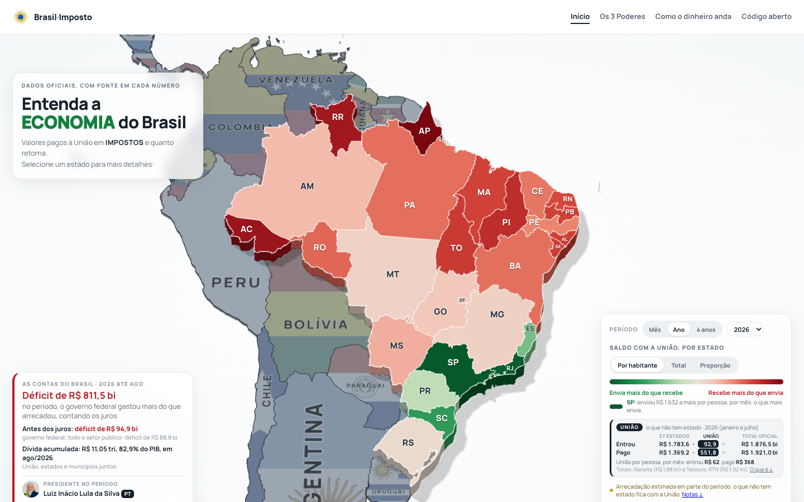
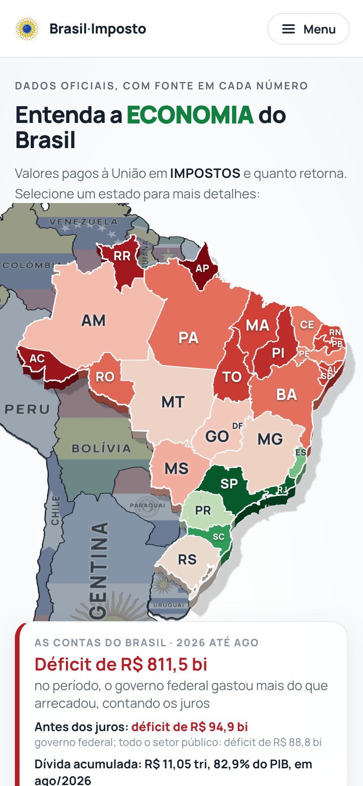

<p align="center">
  
</p>

<h1 align="center">Brasil·Imposto</h1>

<p align="center">
  <b>Para onde vai o imposto, com dados oficiais e a fonte de cada número.</b><br>
  Mapa cívico, apartidário e de código aberto do dinheiro público brasileiro.
</p>

<p align="center">
  <a href="https://brasil-imposto.github.io"><b>Abrir o site</b></a> ·
  <a href="https://github.com/Brasil-Imposto">Como contribuir</a> ·
  <a href="https://github.com/Brasil-Imposto/brasil-imposto.github.io/issues">Issues</a> ·
  <a href="https://github.com/Brasil-Imposto/brasil-imposto.github.io/discussions">Discussions</a> ·
  <a href="#in-english">English</a>
</p>

<p align="center">
  <a href="https://github.com/Brasil-Imposto/brasil-imposto.github.io/actions/workflows/ci.yml"></a>
  <a href="https://github.com/Brasil-Imposto/brasil-imposto.github.io/actions/workflows/pages.yml"></a>
  <a href="https://scorecard.dev/viewer/?uri=github.com/Brasil-Imposto/brasil-imposto.github.io"></a>
</p>

<p align="center">
  
</p>

## O que é

O Brasil-Imposto mostra, com dados oficiais, como o imposto pago no Brasil é arrecadado e redistribuído entre a União, os
estados e os municípios, quem ocupa cada cargo dos três Poderes e quanto recebe, e para onde vai o dinheiro. Cada número tem a
fonte oficial ao lado, com o link, o período e a data da coleta.

**Estado:** primeira versão pública (v1). As páginas são arquivos HTML estáticos montados a partir dos dados deste repositório e
publicados no GitHub Pages em dois sites: o de testes, <https://brasil-imposto.github.io/staging/>, refeito a partir do ramo `staging` (hoje pelo mantenedor; automático quando o token do disparo existir),
e a produção, <https://brasil-imposto.github.io>, que recebe uma tarefa aprovada por vez, levada do `staging` para a `main`. O site definitivo, em Astro, está em
construção.

## As páginas

### Início: o mapa



O mapa do Brasil com o saldo de cada estado com a União: o que foi para a União menos o que voltou, por mês, ano ou mandato
desde 2019, por habitante, no total ou em proporção. Ao lado, as contas do Brasil no período (resultado, juros e dívida) e quem
presidia o país. Cada estado abre uma janela com a sua conta; SC e RS mostram também os municípios, e o DF as Regiões
Administrativas.

Abrir: <https://brasil-imposto.github.io>

<br clear="right">

### Os 3 Poderes


A árvore dos cargos da União e a ficha de cada pessoa: os 513 deputados, os 81 senadores, o presidente, o vice, os ministros de
Estado e os ministros dos tribunais superiores, com o salário, cada auxílio e o que cada um usou em 2026. Para cada parlamentar,
cada projeto que apresentou e o que aconteceu com ele. Em cada ficha, "Pedir correção" abre o formulário já preenchido.

Abrir: <https://brasil-imposto.github.io/os-3-poderes.html>

### Como o dinheiro anda


Quem cobra cada imposto, as partes que a Constituição manda passar de um governo para o outro, quem gasta o quê e o que vira
dívida, com os números de 2025. Três formas contam o mesmo caminho: siga R$ 100 de um imposto, os seis passos do dinheiro e o
grande fluxo do ano.

Abrir: <https://brasil-imposto.github.io/como-o-dinheiro-anda.html>

## De onde vêm os números

Receita Federal (arrecadação por estado), Tesouro Nacional (Resultado do Tesouro Nacional e SICONFI), Portal da Transparência
(gastos, repasses, folha, cartões e viagens), INSS, MDS, IBGE (população e PIB), Câmara dos Deputados, Senado Federal, CNJ e os
tribunais superiores, TSE, Planalto (leis e Constituição) e os portais dos estados e municípios cobertos. Os scripts que buscam e
montam cada base estão em `pipelines/` e `docs/superpowers/tools/`; as pesquisas que explicam cada escolha estão em
`docs/research/`, e as decisões do projeto em [`docs/decisions/README.md`](docs/decisions/README.md).

Regras de método que aparecem na tela:

- **Sem informação de estado:** o dinheiro que a fonte oficial não põe em nenhum estado fica num bloco próprio, nunca espalhado
  pelos estados.
- **DF, estimativa:** a Receita registra no DF o imposto que órgãos e empresas com sede em Brasília retêm ou pagam pelo país
  inteiro (Lei 9.779/1999, art. 15). No mapa, em cada imposto o DF conta no máximo a sua parte no PIB do Brasil (IBGE); o que
  passa disso vai para o bloco da União. A outra estimativa do saldo são os meses de fevereiro de 2025 a janeiro de 2026, em que
  a Receita lançou no DF a arrecadação de outros estados; nos dois casos a tela diz que é estimativa.
- **Repasse não é gasto:** dinheiro que só passa de um governo para outro não conta como gasto de quem só repassou.

**Correções:** quando um número publicado muda por correção, a mudança entra no registro público [`data/corrections.json`](data/corrections.json): o que estava, o que ficou, por quê, quando, a fonte oficial e o pull request.

## Neutralidade

Só dados oficiais, com fonte; nenhum chamado ao voto; o mesmo tratamento para qualquer governo e qualquer partido; pessoas
aparecem só com o papel que têm num documento oficial. As regras completas, e quem decide no projeto, estão em
[`GOVERNANCE.md`](GOVERNANCE.md).

## Como abrir na sua máquina

Só é preciso Python 3, sem pacotes extras:

```
python3 docs/superpowers/tools/build-cases.py
python3 docs/superpowers/tools/build-standalone-data.py
python3 docs/superpowers/tools/build-simulation.py
python3 docs/superpowers/tools/build-platform-preview.py
```

A página Como ler o mapa lê as notas de `assets/map-notes.js`, que pede também o Node:
`node docs/superpowers/tools/build-map-notes.cjs`.

Depois, abra os arquivos das páginas no navegador pelo caminho do arquivo (eles ficam em `docs/superpowers/previews/`). Os
pacotes `assets/bi-data.js`, `assets/bi-federal.js`, `assets/map-notes.js` e `assets/bi-geo*.js` não ficam no repositório: são
refeitos por esses comandos a partir de `data/`.

Os pipelines de `pipelines/` e os testes usam Python 3.12 com as versões fixadas em `uv.lock`: instale o
[uv](https://docs.astral.sh/uv/) e rode `uv sync --locked`, depois `uv run python -m unittest discover -s pipelines/tests`.

**Conferir tudo como o `ci`** (Python 3.12 com uv, Node 24; cerca de um minuto e meio):

```
uv sync --locked
uv run --locked python docs/superpowers/tools/check-all.py
```

As sondas no navegador usam as variáveis `PW_CORE`, `CHROME_HEADLESS` e `CDN_MIRROR`. O passo a passo, os erros comuns e a
revisão estão no [`CONTRIBUTING.md`](CONTRIBUTING.md), seção "Para desenvolver".

### O site em Astro (em construção)

A pasta `site/` tem o esqueleto do site definitivo: Astro 7, TypeScript estrito e uma página de prova que lê os arquivos de cada
entidade, gerados a partir de `data/` e conferidos com os esquemas de `schemas/`. Com Node 24 e o uv:

```
cd site && npm ci && npm run entities && npm run types && npm run check && npm test && npm run build
```

O site no ar continua sendo o das páginas acima até a última fase do Astro.

## Como o repositório é organizado

| Pasta | O que tem |
|---|---|
| `data/` | Os dados publicados, um arquivo por base, com a fonte e a data da coleta |
| `pipelines/` | Os scripts que buscam e montam cada base, e os testes |
| `docs/superpowers/tools/` | Os construtores das páginas e as ferramentas de conferência |
| `docs/superpowers/previews/` | As três páginas publicadas e o que elas carregam (`assets/`) |
| `docs/research/` | As pesquisas por trás de cada número e de cada regra |
| `docs/decisions/` | O registro das decisões do projeto e das perguntas em aberto |
| `docs/superpowers/specs/` e `plans/` | O desenho aprovado de cada mudança e o plano de cada fase |
| `schemas/` e `site/` | Os esquemas JSON e o site em Astro |
| `.github/` | Os formulários de issue, o modelo de pull request e as automações (`ci`, `dco`, `pages`) |

## Estado do projeto

**Pronto (v1):** as três páginas acima; o saldo dos 27 estados com a União por mês, ano e mandato desde 2019; as contas do
Brasil; os municípios de SC e do RS e as Regiões Administrativas do DF; Os 3 Poderes com 722 fichas; o pacote de colaboração
(formulários de issue, modelo de pull request, governança, código de conduta, segurança e o check do DCO).

**O que vem** (cada item é uma issue aberta):

- O site em Astro, fase por fase, cada fase aprovada antes do código: [B1](https://github.com/Brasil-Imposto/brasil-imposto.github.io/issues/3) a [B5](https://github.com/Brasil-Imposto/brasil-imposto.github.io/issues/7).
- "Pedir correção" em todas as páginas ([#9](https://github.com/Brasil-Imposto/brasil-imposto.github.io/issues/9)).
- CI de proveniência ([#10](https://github.com/Brasil-Imposto/brasil-imposto.github.io/issues/10)) e OpenSSF Scorecard ([#11](https://github.com/Brasil-Imposto/brasil-imposto.github.io/issues/11)).
- Guias dos pipelines e documentos de fontes e créditos ([#12](https://github.com/Brasil-Imposto/brasil-imposto.github.io/issues/12)).
- O salário de 3 ministros licenciados da Câmara ([#13](https://github.com/Brasil-Imposto/brasil-imposto.github.io/issues/13)).
- Os municípios de outros estados ([#14](https://github.com/Brasil-Imposto/brasil-imposto.github.io/issues/14)).

## Como ajudar

Corrigir um número, acrescentar uma fonte, cobrir os municípios de um estado, propor um caso ou relatar um defeito: comece por um
dos [formulários de issue](https://github.com/Brasil-Imposto/brasil-imposto.github.io/issues/new/choose). Mudanças entram por pull
request para o ramo `staging`, são conferidas no site de testes e só depois vão à produção; as regras para virar colaborador e
para documentar um pull request estão na [página da organização](https://github.com/Brasil-Imposto). Perguntas e ideias ficam em
[Discussions](https://github.com/Brasil-Imposto/brasil-imposto.github.io/discussions); falhas de segurança se relatam em privado
([`SECURITY.md`](SECURITY.md)); a convivência segue o [código de conduta](CODE_OF_CONDUCT.md).

## Licenças

Código: AGPL-3.0 ([`LICENSE`](LICENSE)). Dados publicados em `data/` e textos: CC BY 4.0 ([`LICENSE-DATA`](LICENSE-DATA)),
citando "Fonte: <órgão>; dados tratados pelo Brasil-Imposto". O dado público de origem segue as regras de cada órgão. Fotos e
bandeiras: a licença e o crédito de cada arquivo estão junto deles.

## In English

Brasil-Imposto is a civic, nonpartisan, open-source map of Brazilian public money built only from official data: how federal,
state and municipal taxes are collected and shared, what each federal officeholder is paid and uses, and where the money goes.
The site is <https://brasil-imposto.github.io>. The pages are static HTML built from `data/` with Python 3 and no extra packages
(commands above); an Astro site is being built phase by phase (issues #3 to #7). Code is AGPL-3.0; data and texts are CC BY 4.0.
Issues and pull requests are welcome, in Portuguese or English; every number needs its official source. Pull requests go to the
`staging` branch, which publishes the test site <https://brasil-imposto.github.io/staging/>; production only receives what was
checked there. How to contribute and
how to document a pull request: <https://github.com/Brasil-Imposto>.
